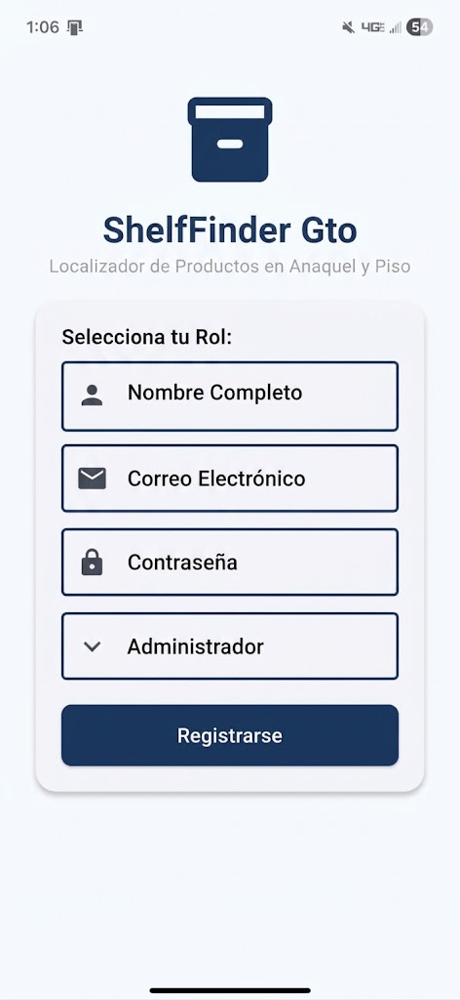
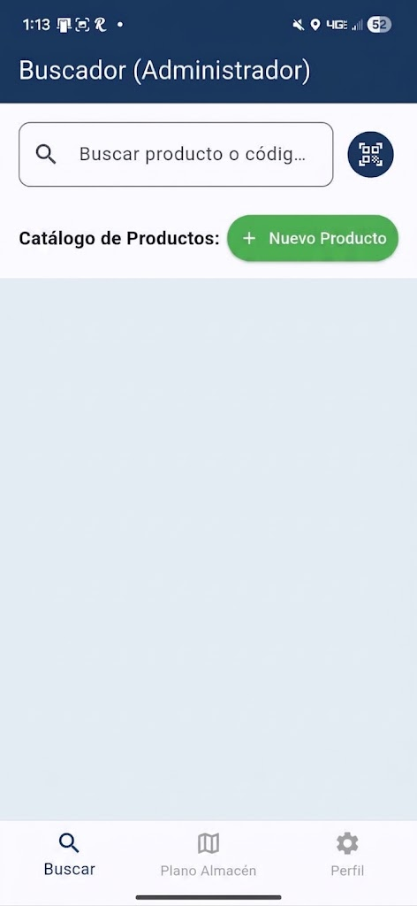
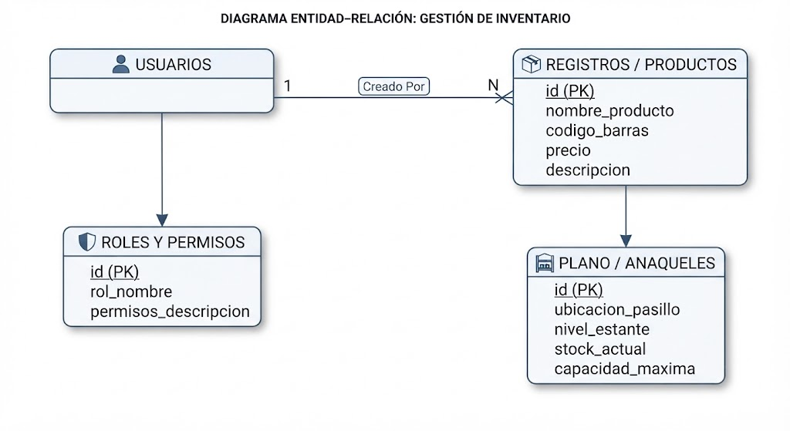

1. Descripción breve
Aplicación móvil desarrollada para buscar productos de algún establecimiento directamente dentro de un croquis o plano de la tienda, permitiendo ubicar de manera rápida y precisa la posición exacta (anaquel y piso) de cada artículo.


2. Los 3 tipos de usuario y sus dashboards
1. **Administrador de Inventario:** Acceso total al catálogo, métricas globales, control de altas/bajas de productos y gestión general del sistema.
2. **Surtidor de Almacén:** Vista operativa enfocada en la consulta de listas asignadas, actualización de stock en tiempo real y localización de mercancía en el plano.
3. **Empleado de Mostrador:** Interfaz rápida para la consulta de precios, códigos de barra y ubicación inmediata de productos solicitados por los clientes en piso de venta.


 3. Manejo de estado elegido (y por qué)
Se utilizó Provider para la gestión del estado de la aplicación.
 Razones de la elección:
  * Permite una gestión ligera y eficiente de los datos del usuario (roles) y del inventario en tiempo real sin sobrecargar la aplicación.
  * Facilita la reactividad en las pantallas de búsqueda y en el plano/croquis al actualizar o filtrar productos de forma instantánea.
  * Mantiene una separación clara entre la lógica de negocio y la interfaz de usuario, optimizando el rendimiento en dispositivos móviles.


## 4. Cómo ejecutar la app

Requisitos previos
* Flutter SDK (versión estable instalada)
* Android Studio / Xcode con un emulador configurado o, en su defecto, el archivo APK listo para instalarse.

Pasos de ejecución
1. **Mediante emulador (Código fuente):**
   * Clonar el repositorio:
     ```bash
     git clonehttps://github.com/Eduardo932-bot/Proyecto_Tacho.git

     cd proyecto_tacho
     ```
   * Obtener las dependencias del proyecto:
     ```bash
     flutter pub get
     ```
   * Ejecutar la aplicación en el dispositivo o emulador conectado:
     ```bash
     flutter run
     ```
2. **Mediante APK creado:**
   * Instalar y ejecutar directamente el archivo APK compilado en un dispositivo Android compatible.

---

## 5. Demostración al docente
Dispositivo del creador 
- **Fecha y modalidad de la demostración: 26 de Octubre de 2026 · Presencial


## 6. Screenshots

### Splashscreen


### Autenticación



### Dashboards


### Listas




### Formularios


### Evidencia funcional


